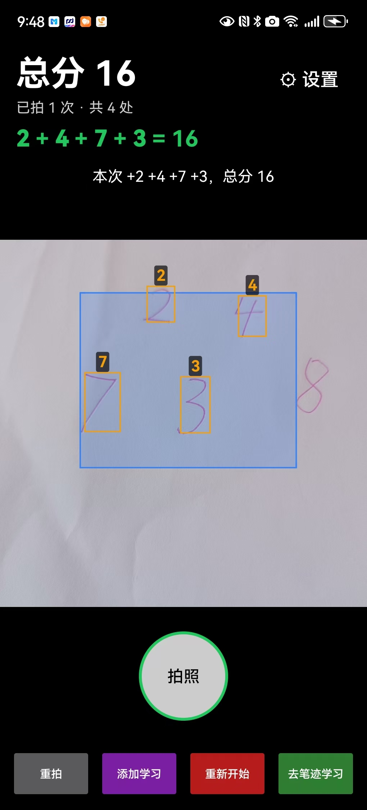
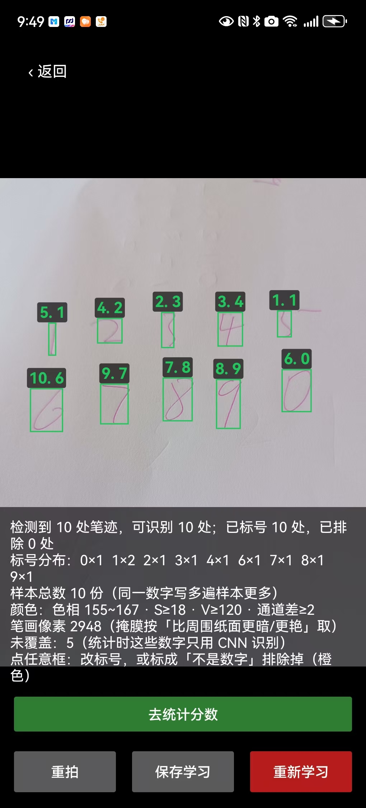
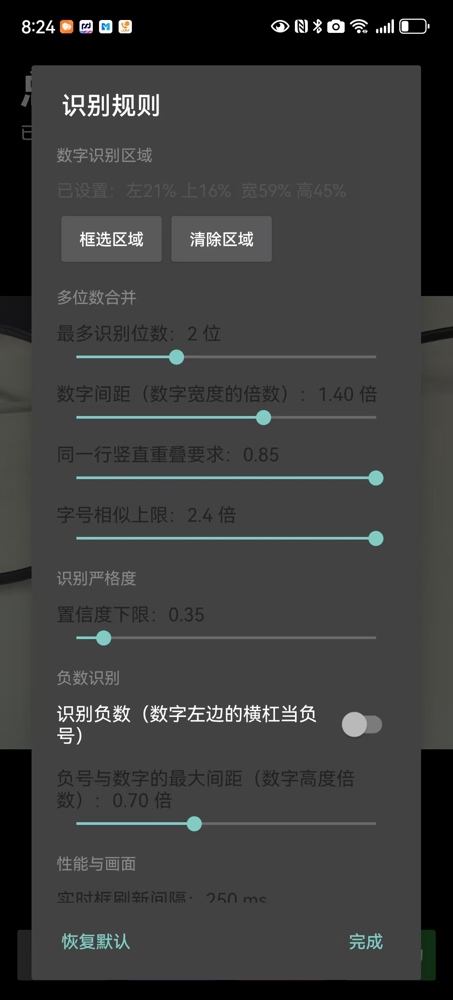

# 分数扫描（Exam Score Scanner）


## 📖 界面预览

| 界面1 | 界面2 | 界面3 |
| :---: | :---: | :---: |
|  |  |  |


用手机摄像头扫试卷上的**红笔手写分数**，实时框出数字、自动累加总分，并配合语音和音效反馈。全部识别在手机本地完成，不上传任何图片。

> 典型场景：老师批改完一摞试卷，用手机对着卷面逐个分数扫一遍，屏幕实时显示「总分」和「已拍次数」，扫完一个学生的卷子点「下一个学生」，自动结算并开始下一份。

---

## 功能特性

- **实时红笔检测**：预览画面里实时画出橙色跟踪框，对准即识别，无需先拍照
- **手写数字识别**：端上 CNN（ONNX Runtime）识别 0–9，支持多位数自动合并（如 9、10、100）
- **按位置去重**：同一处分数只计一次；卷面上不同位置出现相同分数照常累加
- **拍照确认**：点「拍照」把当前画面上的数字正式计入，避免手抖误计
- **语音 / 音效反馈**：播报「N 分」「总分 M 分」，用系统 TTS，国产 ROM 缺中文语音包时自动回退到内置 mp3
- **学生结算**：一个学生扫完点「下一个学生」，保留历史记录并清零开始下一份
- **可调识别规则**：设置页可调最大位数、数字合并间距、置信度阈值、实时刷新间隔、模糊帧阈值
- **数字识别区域（ROI）**：可在设置里框选只识别屏幕某块区域，排除卷面其他红笔批注干扰
- **纯端上运行**：无网络请求，无账号，无数据上传

---

## 工作原理

```
相机帧
  └─ 颜色分割（HSV 红色掩码）
      └─ 连通域分析
          └─ 字形归并（同行 + 字号相近 + 间距足够近 → 合成一个多位数）
              └─ 几何过滤（剔除 √ × 圈画 下划线 印章等干扰）
                  └─ ONNX CNN 逐字识别
                      └─ 按页面坐标去重 → 累加总分 → 叠加层绘制 + 语音播报
```

- **只看红色像素**：黑色印刷体、蓝色笔迹天然被排除，不需要额外分类模型。
- **几何规则剔除干扰**：打勾、打叉、圈画、下划线、印章等靠宽高比、笔画密度、位置关系等规则过滤。
- **去重不看数值看位置**：同一学生卷面出现两个「10 分」是正常的，所以用归一化页面坐标的重叠度判断是否重复。

核心文件：

| 文件 | 职责 |
|------|------|
| `ScorePipeline.kt` | 红笔检测流水线（移植自 Python 原型） |
| `DigitRecognizer.kt` | ONNX 模型加载与单字识别 |
| `FrameTracker.kt` / `SessionState.kt` | 跨帧跟踪、按位置去重、会话累加 |
| `OverlayView.kt` | 跟踪框、加分动画、ROI 调整矩形的绘制与手势 |
| `MainActivity.kt` | 相机预览、拍照、统计算式、设置面板 |
| `Speaker.kt` / `CoinSound.kt` | 语音播报与音效 |
| `ScanSettings.kt` | 识别参数持久化（SharedPreferences） |
| `CalibrationActivity.kt` / `Calibrator.kt` | 手写笔迹学习（可选，提升个人字迹识别率） |

---

## 项目结构

```
exam-score-scanner/
├── android/                 # Android 原生 App（Kotlin + OpenCV + ONNX Runtime）
│   ├── app/src/main/
│   │   ├── java/com/examscan/score/   # 全部 Kotlin 源码
│   │   ├── assets/
│   │   │   ├── digit_cnn.onnx         # 手写数字识别模型
│   │   │   └── audio/                 # 0~100 分的「N分」语音兜底
│   │   └── res/                       # 布局与资源
│   ├── build.gradle.kts
│   └── gradlew.bat
├── server/                  # Python 原型服务（FastAPI + OpenCV，早期验证用）
└── miniprogram/             # 微信小程序原型（早期方案，已不维护）
```

> 正式使用的是 `android/` 目录。`server/` 是算法原型与模型导出脚本（`export_onnx.py`），`miniprogram/` 是早期小程序方案，保留作参考。

---

## 构建与运行

### 环境要求

- Android Studio（推荐最新稳定版）或命令行 Gradle
- JDK 17
- Android SDK Platform 34、Build-Tools 34.0.0

### 用 Android Studio

1. `File → Open` 选择 `android/` 目录，等待 Gradle 同步完成
2. 连接手机（开启 USB 调试）或启动模拟器，点 Run
3. 生成 APK：`Build → Build Bundle(s) / APK(s) → Build APK(s)`

### 用命令行

```powershell
cd android
.\gradlew.bat assembleDebug
```

产物路径：

```
android/app/build/outputs/apk/debug/app-debug.apk
```

### 正式发布（Release）

`Build → Generate Signed Bundle / APK`，创建或选择自己的密钥库后生成 `app-release.apk`。
签名密钥和密码请自行妥善备份，不要提交到仓库。

### 注意事项

- `android/local.properties` 里是本机 SDK 路径，属于个人环境配置，**不要提交**，Android Studio 打开时会自动生成。
- 模型文件 `.onnx` 和语音 `.mp3` 在 `build.gradle.kts` 中配置了 `noCompress`，不要改成压缩，否则运行时无法按文件路径读取。
- 最低支持 Android 7.0（API 24），`abiFilters` 只保留 `arm64-v8a` 和 `armeabi-v7a`。

---

## 使用说明

1. 首次启动授予相机权限
2. 把红笔批改的分数放进取景框，画面出现橙色框即表示识别到数字
3. 点「拍照」确认计入，上方算式会显示本次加分和总分
4. 一个学生扫完点「下一个学生」结算，继续下一份
5. 识别不准时可在「⚙ 设置」里调整参数，或「去笔迹学习」录入自己的字迹样本

### 常用参数

| 参数 | 说明 |
|------|------|
| 最大位数 | 一个多位数最多合并几位（1 = 每个数字单独算） |
| 合并间距 | 相邻数字间距小于「数字宽度 × 该倍数」才合并 |
| 置信度下限 | 越高越严格，误识别少但漏检多 |
| 行重叠 / 字号相似 | 判断两个数字是否同属一个多位数 |
| 实时刷新间隔 | 越小越跟手，但更耗电 |
| 模糊阈值 | 画面太糊时跳过识别 |

---

## 技术栈

- Kotlin，Android 原生（`minSdk 24` / `targetSdk 34`）
- CameraX（相机预览与取帧）
- OpenCV 4.10.0（颜色分割、形态学、连通域）
- ONNX Runtime Android 1.17.3（手写数字 CNN 推理）
- TextToSpeech + MediaPlayer（语音播报）

---

## 隐私

所有图像处理与识别均在设备本地完成，App 不包含任何联网上传逻辑，不申请存储与网络权限，仅使用相机权限。

---

## 已知限制

- 主要针对**红笔**手写分数，其他颜色的笔识别效果有限
- 字迹过于潦草或分数被遮挡时可能漏检 / 误检
- 光线过暗或画面模糊时会跳过识别（可调模糊阈值）
- 目前仅适配竖屏

---

## License

MIT License
